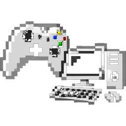
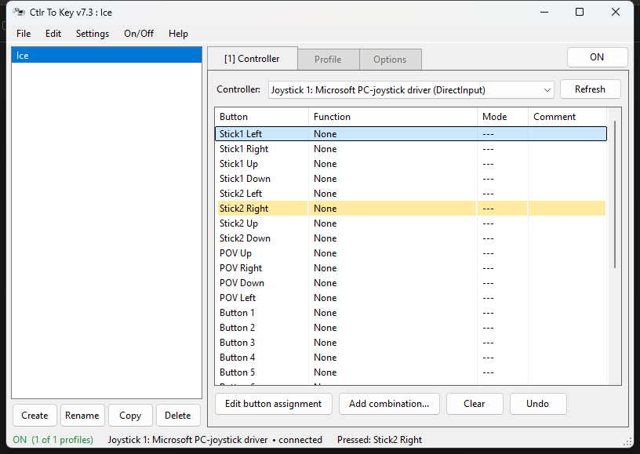

<p align="center">
  
</p>

<h1 align="center">Ctlr To Key</h1>

<p align="center">
  Turn your controller into a keyboard. Map buttons and button combos to shortcuts, macros, or app launchers.<br>
  One small exe. No installer. No extra runtimes.
</p>

<p align="center">
  
</p>

## Features

- **Buttons and combos** - map any single button, or a combination like `LB + A`, to a key or shortcut such as `Ctrl + Alt + T`.
- **Tap, Hold or Repeat** - press a key once, hold it while the button is held, or auto-fire.
- **Short press and long press** - give a button one action when tapped and another when held.
- **Macros** - chain steps together: press keys, wait, type text, open programs.
- **Launch anything** - open programs, files, folders or websites from a button.
- **Multiple profiles** - keep a profile per game or app, and run several at the same time.
- **ON/OFF switch** - turn everything off in one click, with a global hotkey (default `Ctrl + Alt + J`), or by holding a controller combo (e.g. `Back + Start`).
- **Lock to a program** - only work while a chosen program (or several) is in front.
- **Import / export** - back up profiles or share them as `.ctkprofile` files.
- **Undo** - `Ctrl + Z` reverts your last changes, including deleted profiles.
- **Classic and Dark themes**, system tray support, start with Windows, always on top.

Works with Xbox / XInput controllers (A, B, X, Y, LB, RB, LT, RT, D-Pad, sticks) and generic DirectInput gamepads and joysticks (Button 1-32, POV hat, sticks).

## Download

Grab `Ctlr To Key.exe` from the [Releases](https://github.com/twizzycodes/CtlrToKey/releases) page and run it. That's it.

Requires Windows 10 or 11 (uses the .NET Framework 4 that ships with Windows).

## How to use

1. Pick a profile on the left, or click **Create** to make a new one.
2. Choose your controller from the **Controller** list. Press a button and its row lights up.
3. Double-click a row (or **Edit button assignment**).
4. Click the key box and press the shortcut you want, or choose **Run a program** or **Macro**.
5. For combos, click **Add combination...** and tick several buttons, or use **Record from controller** and press them together.
6. For a second action when holding a button, open the **Long press** tab in the edit window.

Right-click a profile to turn it on or off. The **ON/OFF** button at the top turns everything off without changing which profiles are on.

### Macro steps

One step per line:

```
key Win + R
wait 300
type notepad
key Enter
```

| Step | What it does |
| --- | --- |
| `key Ctrl + C` | Press a key or shortcut |
| `down Shift` / `up Shift` | Hold or release a key |
| `wait 500` | Wait in milliseconds |
| `type hello` | Type text |
| `run https://github.com` | Open a program, file, folder or website |

Lines starting with `#` are ignored.

## Settings

Settings are saved automatically to `CtlrToKey.xml` next to the exe, so you can keep the whole thing on a USB stick. If that folder is read-only, it falls back to `%APPDATA%\CtlrToKey`.

Under **Options** you can change the theme, stick deadzone, trigger sensitivity, combo timing, repeat speed, the ON/OFF hotkey and controller combo, lock-to-program, and window behavior. If a game ignores the keys, try **Send keys as scan codes**.

## Building from source

No Visual Studio needed. Open a command prompt in the `src` folder and run the C# compiler included with Windows:

```
%WINDIR%\Microsoft.NET\Framework64\v4.0.30319\csc.exe /nologo /target:winexe /optimize+ /out:"Ctlr To Key.exe" /win32icon:app.ico /win32manifest:app.manifest /resource:app.ico,CtlrToKey.app.ico /r:System.Windows.Forms.dll /r:System.Drawing.dll /r:System.Xml.dll /r:System.Core.dll *.cs
```

## Credits

Made by Zerx/Twizzy.
